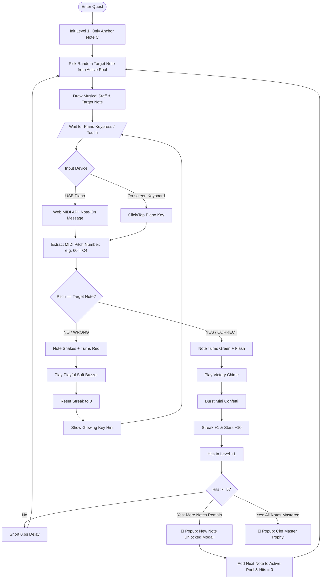
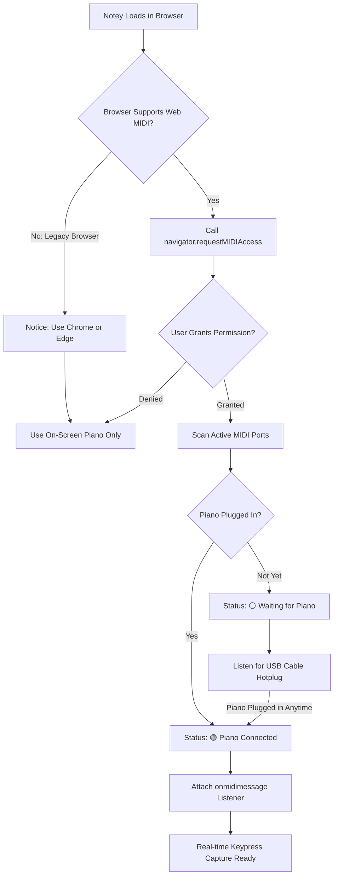

# 🎼 Notey - System & User Flowcharts

This document outlines the architecture, user journeys, MIDI hardware connectivity, and incremental learning gameplay loop for **Notey**.

---

## 1. High-Level User Journey (Streamlined 2-Screen Flow)

Because the mode selector is integrated directly into the landing page, there are no redundant intermediate screens.

```mermaid
flowchart TD
    Start([User Visits Notey]) --> Landing[Landing Page]
    
    subgraph LandingHub [Landing Page Features]
        Landing --> HeroBanner[Pure 3D Cinematic Piano Wonderland]
        Landing --> SelectorBar[Docked Mode Selector Bar]
        Landing --> QuickTrial[Live Interactive Note Trial Board]
    end

    subgraph SelectorModes [Tabs: All | Learn | Challenge]
        SelectorBar --> TabLearn[Learn: Treble Clef, Bass Clef, Grand Staff, Starter]
        SelectorBar --> TabChallenge[Challenge: Daily Streak 60s, Speed Rush, Mini Melodies]
    end

    TabLearn -->|Click Any Quest Card| PlayArena[🎮 Enter Play Arena Directly]
    TabChallenge -->|Click Any Quest Card| PlayArena
    HeroBanner -->|Click 'Play Now'| PlayArena

    subgraph GameplayExperience [Arena Latihan]
        PlayArena --> IncrementalEngine[Incremental Note Progression Engine]
        IncrementalEngine --> Level1[Level 1: Only Note C]
        Level1 -->|5 Correct Hits| UnlockD[Level 2: Unlock D -> Pool [C, D]]
        UnlockD -->|5 Correct Hits| UnlockE[Level 3: Unlock E -> Pool [C, D, E]]
        UnlockE -->|Progressively| ClefMaster[🏆 Clef Master: All Notes Unlocked!]
    end

    PlayArena -->|Click 'Quests' Back Button| Landing
```

---

## 2. Core Incremental Gameplay Loop



---

## 3. Web MIDI Hardware Connectivity


