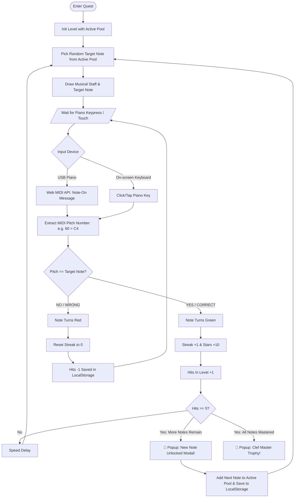
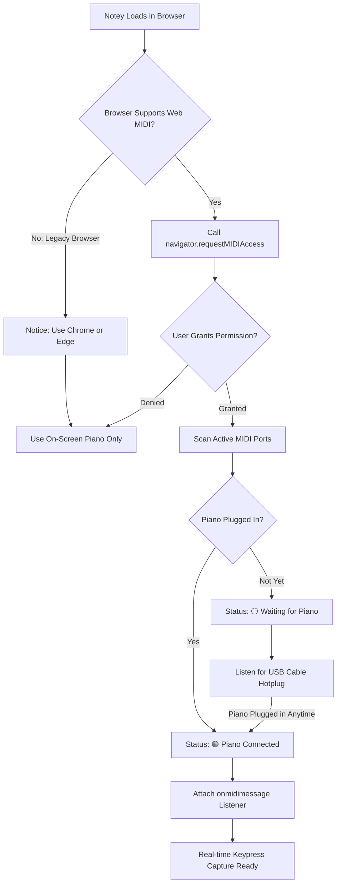

# 🎼 Notey - System & User Flowcharts

This document outlines the architecture, user journeys, 3D Quest Roadmap, MIDI hardware connectivity, and incremental learning gameplay loop for **Notey**.

---

## 1. High-Level User Journey (3D Quest Roadmap Hub)

```mermaid
flowchart TD
    Start([User Visits Notey]) --> Landing[Landing Page]
    
    subgraph LandingHub [Landing Page Features]
        Landing --> HeroBanner[Pure 3D Cinematic Piano Wonderland]
        Landing --> SelectorBar[Docked Mode Selector Bar]
        Landing --> QuickTrial[Live Interactive Note Trial Board]
    end

    Landing -->|Click 'Play Now' or Quest Cards| Roadmap[🗺️ 3D Quest Roadmap Page]

    subgraph 3DIslandRoadway [3D Floating Island Roadmap]
        Roadmap --> TabTreble[🎼 Treble Clef Path: Level C4 to C5]
        Roadmap --> TabBass[🎹 Bass Clef Path: Level C4 to C3]
        Roadmap --> TabGrand[🌟 Grand Staff Path: Level C3 to C5]
        
        Roadmap --> IslandTiers[3-Tier Mountain Island with Winding Road]
        IslandTiers --> NodeCompleted[Level Checked / Green]
        IslandTiers --> NodeActive[Current Level Pulse / PLAY]
        IslandTiers --> NodeLocked[Upcoming Levels Locked 🔒]
    end

    NodeActive -->|Tap Level Checkpoint| PlayArena[🎮 Enter Play Arena Directly]
    NodeCompleted -->|Replay Level| PlayArena

    subgraph GameplayExperience [Arena Latihan]
        PlayArena --> IncrementalEngine[Incremental Note Progression Engine]
        IncrementalEngine --> Level1[Level C4: Only Note C]
        Level1 -->|5 Correct Hits| UnlockD[Level D4: Unlock D -> Pool [C, D]]
        UnlockD -->|5 Correct Hits| UnlockE[Level E4: Unlock E -> Pool [C, D, E]]
        UnlockE -->|Progressively| ClefMaster[👑 Clef Master: All Notes Unlocked!]
    end

    PlayArena -->|Click 'Quests' Back Button| Roadmap
    Roadmap -->|Click 'Home' Back Button| Landing
```

---

## 2. Core Incremental Gameplay Loop



---

## 3. Web MIDI Hardware Connectivity


